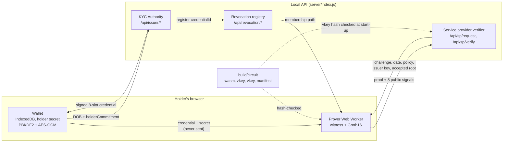

# Privacy-Preserving Digital KYC

A local prototype that issues a signed KYC credential, stores it in an encrypted browser wallet, and proves selected claims with a Groth16 zero-knowledge proof. The service-provider verifier checks the issuer, request policy, challenge, and current revocation root. The holder's date of birth and wallet secret are not sent in the proof-submission request.

This is a classroom/demo prototype, not a production identity or KYC service. The local demo issuer accepts a user-entered date of birth and marks KYC as verified; it does not check identity documents or perform real KYC. Issuer and setup keys are development-only.

## Requirements and setup

- Node.js 20+
- npm

```powershell
npm install
npm test
```

`npm test` builds the starter circuits and runs the credential, wallet, verifier, prover, and credential-bound circuit tests. The merged presentation circuit is compiled by the circuit tests; these tests may take several minutes on a laptop.

`npm test` rebuilds only the starter test circuits; the presentation proving keys created by `npm run setup:demo` are kept, so the website still works after a test run. The end-to-end test (`test/e2e.test.mjs`) compiles its own copy of the presentation circuit under `build/test-e2e` and pushes real Groth16 proofs through the verifier.

## Run the website demo

Create local proving artifacts for the credential-bound presentation circuit, then start the API and Vite site:

```powershell
npm run setup:demo
npm run dev
```

The first `npm run setup:demo` compiles the 11,923-constraint circuit and creates a local Powers of Tau file; it can take several minutes. Let it finish before starting the website.

Open `http://localhost:5173`.

1. Enter a wallet passphrase (at least 8 characters) and choose **Create / unlock wallet**. The holder secret is generated in the browser and encrypted in IndexedDB.
2. Enter a date of birth and choose **Issue and store demo credential**. The local demo issuer signs an 8-slot Poseidon credential root bound to the wallet's holder commitment and registers its ID in the active set.
3. Choose **Generate & verify**. A consent screen lists what the service provider will learn and what stays in the wallet. After **Approve & prove**, the browser builds the witness and Groth16 proof in a Web Worker. It sends only the proof, public signals, and request ID to `/api/sp/verify`.
4. The receipt shows whether the proof passed, the per-service nullifier, the public signals, proof timings, and proof size. The **Network inspector** at the bottom lists every request the page sent. **Export / Import credential** moves a credential between wallets, and an import is refused if the issuer signature does not verify. Use the **Service Provider (SP)** tab to inspect a challenge and revoke the displayed credential ID; after revocation, a new proof must fail.

The issuer's public key is served at `GET /api/issuer/key`. Credentials are issued by `POST /api/issuer/issue` (alias `/api/demo/issue`). The local demo issuer key is stored at `build/demo-issuer-key.json` so the demo wallet keeps working across API restarts. It is ignored by Git and must never be used in a real deployment. Deleting it invalidates credentials issued by that local demo key. `npm run setup:demo` creates a development-only Powers of Tau file (cached under `build/ptau/`) and circuit-specific keys; an external ceremony file can be selected with `PTAU_FILE`.

The browser downloads the proving WASM and zkey from the API and verifies their hashes against `build/circuit/manifest.json`. If setup or circuit sources change, rerun `npm run setup:demo`. Do not reuse the development setup for production.

## Useful commands

```powershell
npm run test:circuit          # merged circuit witness/security cases + V7 ablation circuits
npm run test:e2e              # real Groth16 proofs through the verifier (replay, tamper, revocation)
npm run circuit:presentation  # compile the credential-bound presentation circuit
npm run setup:demo            # compile and create local proving/verification artifacts
npm run build                 # build the website
npm run bench                 # Node proof benchmark
npm run bench:browser         # browser/worker benchmark after setup:demo
```

## Architecture



Only the issuer request carries the date of birth. The website's **Network inspector** shows every request body and flags any that contain it.

## How the proof works

- An issuer signs the Poseidon root of eight fixed credential slots.
- The circuit checks issuer signature, credential-tree consistency, age threshold, KYC status, expiry, holder-secret binding, and active-set membership.
- Public signals are ordered as `[nullifier, issuerAx, issuerAy, currentDate, minAgeOffset, challenge, spId, revocationRoot]`.
- The verifier binds those signals to its trusted issuer and the challenge record, accepts only the current revocation root, and consumes a challenge only after a valid proof.

See [spec/claim-interface.md](spec/claim-interface.md) for the circuit interface, [spec/credential-format.md](spec/credential-format.md) for the credential and disclosure policy, [docs/prover-pipeline.md](docs/prover-pipeline.md) for the proof pipeline and performance, and [docs/demo-script.md](docs/demo-script.md) for the presentation walk-through.

## Project areas

- `src/credential/`: issuer-signed Poseidon/Merkle credentials
- `circuits/`: age, signature, credential-tree, holder-binding, and revocation constraints
- `src/prover/`: setup, witness/proof generation, browser proving, and performance tools
- `src/wallet/`: encrypted holder secret and credential storage
- `src/verifier/`: public-input checks, challenge/replay protection, revocation, and audit log
- `server/`, `web/`: local demo API and website
