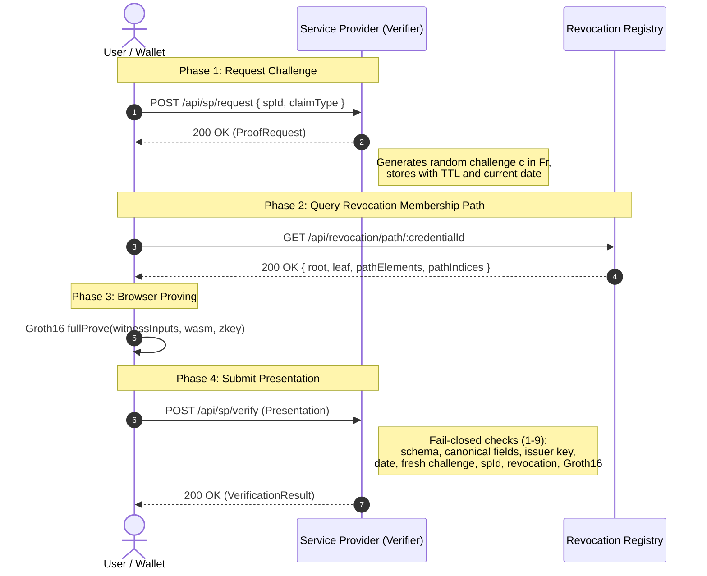

# Verifier and Wallet Protocol Specification

**Project**: Privacy-Preserving Digital KYC System Using Zero-Knowledge Proofs  
**Author**: Someshwar Singh (231020) — Verification, Security and Optimization  
**Scope**: Canonical message schemas and protocol exchange between User Wallet, Service Provider (Verifier), and Revocation Registry.

---

## 1. Protocol Flow Overview



---

## 2. Message Formats

### 2.1 Proof Request (`POST /api/sp/request`)

Initiated by the wallet or service provider frontend when initiating an age/KYC verification session.

#### Request Body
```json
{
  "spId": "sp_financial_demo",
  "claim": "age_and_kyc"
}
```

#### Response: `ProofRequest`
```json
{
  "requestId": "req_a8f9c104e7b2",
  "challenge": "1847291048291048201948201948201948201948201948201948201948201948",
  "spId": "123456789012345",
  "currentDate": 20261102,
  "minAgeOffset": 180000,
  "trustedIssuer": {
    "ax": "11513271168449174522649033324628286280208269784305886616238612196620584742680",
    "ay": "4525892543290680321743110595304724213031024621041926618587428172605809756083"
  },
  "acceptedRevocationRoots": [
    "20875382947104928192847291048291048201948201948201948201948201948"
  ],
  "issuedAt": "2026-11-02T17:50:00.000Z",
  "expiresAt": "2026-11-02T17:55:00.000Z"
}
```

#### Field Specifications:
- `requestId`: Unique ephemeral session tracking ID.
- `challenge`: Random 254-bit scalar field element represented as a decimal or hex string ($0 < challenge < r$).
- `spId`: Numeric field element representation of the relying party identity.
- `currentDate`: Calendar date encoded in `YYYYMMDD` integer format.
- `minAgeOffset`: Threshold integer subtracted from `currentDate` (default: `180000` representing 18 years).
- `trustedIssuer`: Object containing BabyJubJub affine coordinates $(A_x, A_y)$ of the accepted KYC Authority.
- `acceptedRevocationRoots`: Array of recently published valid roots of the active credential Poseidon Merkle tree.
- `expiresAt`: ISO 8601 UTC timestamp after which the challenge is invalidated.

---

### 2.2 Presentation Submission (`POST /api/sp/verify`)

Submitted by the wallet containing the Groth16 zero-knowledge proof and matching public signals.

#### Request Body: `Presentation`
```json
{
  "requestId": "req_a8f9c104e7b2",
  "proof": {
    "pi_a": [
      "1234567890123456789012345678901234567890123456789012345678901234",
      "2345678901234567890123456789012345678901234567890123456789012345",
      "1"
    ],
    "pi_b": [
      [
        "3456789012345678901234567890123456789012345678901234567890123456",
        "4567890123456789012345678901234567890123456789012345678901234567"
      ],
      [
        "5678901234567890123456789012345678901234567890123456789012345678",
        "6789012345678901234567890123456789012345678901234567890123456789"
      ],
      [
        "1",
        "0"
      ]
    ],
    "pi_c": [
      "7890123456789012345678901234567890123456789012345678901234567890",
      "8901234567890123456789012345678901234567890123456789012345678901",
      "1"
    ],
    "protocol": "groth16",
    "curve": "bn128"
  },
  "publicSignals": [
    "nullifier_decimal_string",
    "issuerAx_decimal_string",
    "issuerAy_decimal_string",
    "20261102",
    "180000",
    "challenge_decimal_string",
    "spId_decimal_string",
    "revocationRoot_decimal_string"
  ]
}
```

#### Canonical Public Signal Order (Index 0 to 7):
The `publicSignals` array MUST contain exactly 8 elements in this deterministic order:
| Index | Signal Name | Visibility | Format | Description |
| :---: | :--- | :--- | :--- | :--- |
| **0** | `nullifier` | Public Output | String($\mathbb{F}_r$) | Pseudonym $\text{Poseidon}(holderSecret, spId)$ |
| **1** | `issuerAx` | Public Input | String($\mathbb{F}_r$) | KYC Authority BabyJubJub X coordinate |
| **2** | `issuerAy` | Public Input | String($\mathbb{F}_r$) | KYC Authority BabyJubJub Y coordinate |
| **3** | `currentDate` | Public Input | String(Integer) | Verifier date in `YYYYMMDD` format |
| **4** | `minAgeOffset` | Public Input | String(Integer) | `180000` (age $\ge 18$) |
| **5** | `challenge` | Public Input | String($\mathbb{F}_r$) | Verifier-issued single-use nonce |
| **6** | `spId` | Public Input | String($\mathbb{F}_r$) | Relying party identifier |
| **7** | `revocationRoot` | Public Input | String($\mathbb{F}_r$) | Merkle root of active credential IDs tree |

---

### 2.3 Verification Result (`POST /api/sp/verify` Response)

#### Success (200 OK)
```json
{
  "accepted": true,
  "status": "VERIFIED",
  "receiptId": "RCPT_8F3B90A2E4",
  "nullifier": "1948201948201948201948201948201948201948201948201948201948201948",
  "verifiedClaims": {
    "ageAtLeast18": true,
    "kycVerified": true,
    "unrevoked": true,
    "holderBound": true
  },
  "metadata": {
    "spId": "123456789012345",
    "currentDate": 20261102,
    "verificationMs": 3.42
  }
}
```

#### Rejection / Failure (400 Bad Request or 200 OK with accepted=false)
```json
{
  "accepted": false,
  "status": "REJECTED",
  "error": "The verification failed policy checks.",
  "code": "CHALLENGE_EXPIRED_OR_REPLAYED",
  "details": [
    "Challenge nonce was already used or has expired."
  ]
}
```

#### Error Codes:
- `INVALID_SCHEMA`: Request payload malformed or missing fields.
- `INVALID_SIGNAL_COUNT`: Public signals array length $\ne 8$.
- `NON_CANONICAL_FIELD_ELEMENT`: A signal integer $\ge r$ or $< 0$.
- `UNTRUSTED_ISSUER`: `(issuerAx, issuerAy)` does not match accepted KYC Authority keys.
- `DATE_MISMATCH`: `currentDate` differs from verifier's operational date.
- `CHALLENGE_EXPIRED_OR_REPLAYED`: Nonce was already consumed, expired, or unknown.
- `SP_ID_MISMATCH`: `spId` does not match this service provider's identifier.
- `REVOCATION_ROOT_REJECTED`: `revocationRoot` is stale or unknown.
- `PROOF_VERIFICATION_FAILED`: Groth16 pairing check failed ($A \cdot B \ne \alpha \cdot \beta + \dots$).

---

## 3. Revocation Registry Protocol Endpoints

### 3.1 Get Current Revocation Root
`GET /api/revocation/root`
```json
{
  "revocationRoot": "20875382947104928192847291048291048201948201948201948201948201948",
  "treeDepth": 16,
  "activeCount": 1042,
  "updatedAt": "2026-11-02T17:45:00.000Z"
}
```

### 3.2 Get Accepted Revocation Root History
`GET /api/revocation/history`
```json
{
  "currentRoot": "20875382947104928192847291048291048201948201948201948201948201948",
  "recentRoots": [
    "20875382947104928192847291048291048201948201948201948201948201948",
    "18765432987104928192847291048291048201948201948201948201948201123"
  ]
}
```

### 3.3 Get Credential Membership Path
`GET /api/revocation/path/:credentialId`
```json
{
  "credentialId": "10042",
  "leaf": "1948201948201948201948201948201948201948201948201948201948201948",
  "root": "20875382947104928192847291048291048201948201948201948201948201948",
  "pathElements": [
    "394820...",
    "194820...",
    "..."
  ],
  "pathIndices": [0, 1, 0, 0, 1, 0, 0, 0, 0, 0, 0, 0, 0, 0, 0, 0]
}
```

### 3.4 Revoke Credential (Issuer Endpoint)
`POST /api/revocation/revoke` (disabled when `NODE_ENV=production`; the demo has no issuer authentication, and a deployment must add it)
```json
{
  "credentialId": "10042"
}
```
Response:
```json
{
  "success": true,
  "alreadyRevoked": false,
  "revokedId": "10042",
  "newRoot": "1192847291048291048201948201948201948201948201948201948201948201"
}
```
Revocation is final: `POST /api/revocation/register` refuses to re-register a revoked ID.

## 4. Issuer (KYC Authority) Endpoints

### 4.1 Issuer Public Key
`GET /api/issuer/key`
```json
{ "publicKey": { "Ax": "<field>", "Ay": "<field>" }, "scheme": "EdDSA-Poseidon / BabyJubJub" }
```

### 4.2 Issue Credential (mock KYC)
`POST /api/issuer/issue` (alias `/api/demo/issue`; disabled when `NODE_ENV=production`)
```json
{ "dob": 20000615, "holderCommitment": "<Poseidon(holderSecret)>" }
```
Response `201`: `{ "credential": <credential JSON, see spec/credential-format.md>, "revocationRoot": "<new active-set root>" }`. The issuer accepts the submitted date of birth as KYC-verified (mock), assigns a random `credentialId`, sets expiry ten years ahead, and registers the ID in the active-credential tree.
